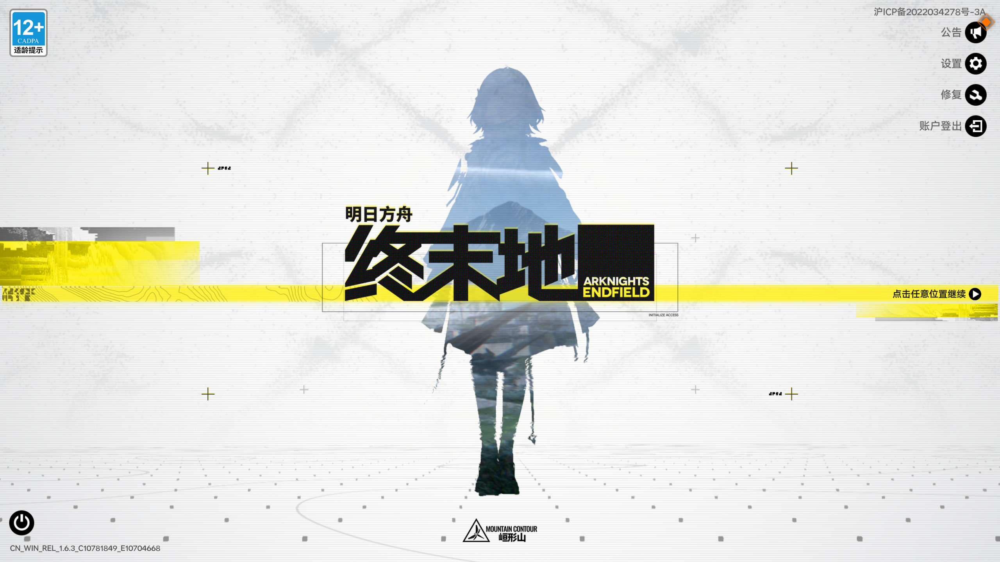

# 明日方舟：终末地 启动代理

双击 **明日方舟：终末地.exe**，直接启动本机已安装的游戏。单个原生 Windows EXE，使用 Endfield 原版图标；运行时无需脚本、额外 DLL 或运行库。

[下载最新版](https://github.com/half-drop/endfield-launch-proxy/releases/latest) · [使用说明与本机验收](docs/使用说明与验收.txt) · [构建流水线](https://github.com/half-drop/endfield-launch-proxy/actions)

## 使用

1. 下载 Release 中的 Windows 压缩包，解压得到准确文件名 `明日方舟：终末地.exe`。也可单独下载 `EndfieldLaunchProxy.exe` 后改名。
2. 确保游戏和鹰角官方启动器已正常安装，并已通过官方启动器完成必要更新。
3. 双击 EXE。已有游戏、启动器或更新器运行时，代理静默退出，保留现有进程。

默认游戏位置：`D:\Hypergryph Launcher\games\Arknights Endfield\Endfield.exe`。移动代理本身不会影响此路径；其他安装位置可在快捷方式中加参数 `--game="完整路径\Endfield.exe"`。

全程不显示代理窗口、控制台或通知。错误写入 `%LOCALAPPDATA%\EndfieldLaunchProxy\launch.log`，不弹窗。当前官方程序需要管理员权限；代理在创建进程前检查现有令牌，权限不足、令牌受限或查询失败时直接静默退出，不请求 UAC，不修改系统设置。游戏自身的窗口、登录和服务端认证照常进行。

## 实现与边界

代理发现本机官方 `Games.exe`，验证系统信任及鹰角签名组织后，以暂停状态创建官方进程，**始终不恢复其主线程**。再使用 Windows `PROC_THREAD_ATTRIBUTE_PARENT_PROCESS` 创建游戏；游戏的本地 SDK 会核对这个真实官方父进程。

等待本次新增 SDK 成功标记以及游戏 Unity 窗口连续响应 10 秒后，代理清理自己创建的暂停父进程，再观察游戏 30 秒后退出。专用 Job 清理只作用于辅助父进程；游戏在开始执行前必须通过进程身份和 Job 隔离检查。已运行的游戏不会被代理主动终止。

此方式不执行官方启动器界面或更新检查。游戏更新请使用官方启动器完成，不能替代必要的登录、安装或修复。依赖当前游戏的启动检查和日志格式，后续版本变化可能需要适配。

实现思路参考 [Better-Endfield v4.0.4 的公开机制](https://github.com/Dr-hydra/Better-Endfield/blob/v4.0.4/native/loaders/shared/official_launcher.cpp)。本仓库为独立 Win32 实现，没有复制该项目源文件，也不包含其 Mod、注入代码、官方启动器或游戏程序。

## 验证

Windows 10 Pro 19045、本机官方启动器 1.6.0.1604、游戏画面标识 CN_WIN_REL_1.6.3 已完成一次真实冷启动验收：SDK 检查成功、游戏窗口就绪、辅助父进程清理、清理后持续响应，以及后续进入游戏。窗口观察未发现代理、启动器或可见控制台窗口。

同时验证了重复启动、已有游戏/启动器保护、文件缺失、非法参数、模拟超时和代理异常退出。具体证据及权限环境见[验收记录](docs/使用说明与验收.txt)。该电脑原有桌面权限较高；未改变 UAC 设置，也未将该结果泛化为所有权限环境均能启动。



Actions 验证原生 x64 GUI 格式、完整图标、版本信息、清单、系统依赖和安全失败路径；云端没有游戏安装，真实游戏启动验收来自上述本机测试。

## 构建与发布

需要 Visual Studio 2022 C++ 工具及 Windows SDK：

```powershell
./scripts/Build.ps1
./scripts/Verify.ps1
./scripts/Package.ps1 -Version v1.0.2
```

编译使用 `/MT` 静态运行库和 Windows GUI 子系统，输出到 `dist/`。`v*` 标签触发 GitHub Actions，构建、验证、打包成功后，先上传草稿，核对 GitHub 实际附件名称与全部 SHA-256，再公开同一次构建的产物。

GitHub 会清洗中文附件名，因此 Release 的单独 EXE 采用 `EndfieldLaunchProxy.exe`。ZIP 内保留 `明日方舟：终末地.exe`，两者字节完全一致；文件内部版本信息仍使用准确中文名称。`SHA256SUMS.txt` 对应实际下载附件名称。这一限制来自 [GitHub Release 资产规则](https://docs.github.com/en/rest/releases/assets#upload-a-release-asset)。

独立代理源码采用 [MIT 许可证](LICENSE)。游戏图标及相关名称归各自权利人所有，见 [第三方说明](THIRD_PARTY_NOTICES.md)。本项目与鹰角网络无官方关联。
